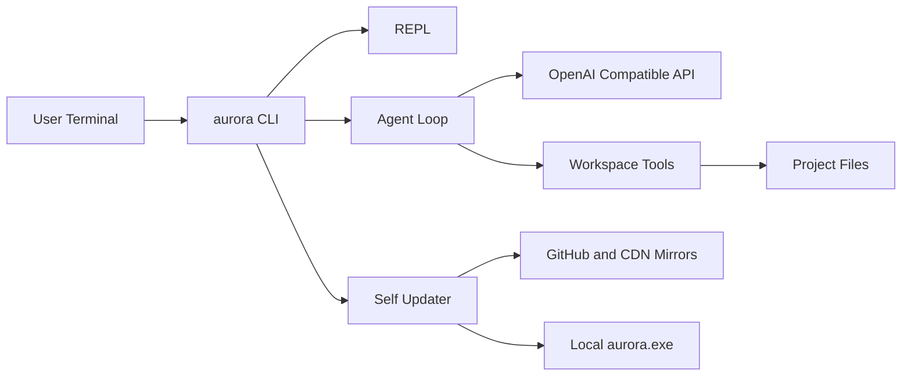

# 架构设计

## 系统概述

Aurora 是本地 CLI。用户在工作区启动进程，REPL 或一次性任务把自然语言交给 Agent 循环。循环调用 OpenAI 兼容接口，模型通过工具读写当前工作区。更新器独立于 Agent，负责从多个镜像拉取新版本并替换自身。

## 技术栈

- Go，CGO 关闭
- 标准库 HTTP / zip / 并发
- 无运行时 GUI 依赖

## 项目结构（建议）

```
cmd/aurora/
internal/agent/
internal/config/
internal/llm/
internal/tools/
internal/tui/
internal/updater/
internal/version/
scripts/
```

## 核心模块/组件

- **CLI**: 子命令路由、一次性任务、REPL
- **Agent**: 多步 tool-calling
- **Tools**: 文件与 shell，限制在工作区根目录内
- **LLM**: `/chat/completions`，优先流式
- **Updater**: manifest 竞速 + 资产竞速 + 校验 + 自替换
- **Installer**: Windows 多镜像下载与 PATH 写入

## 架构图



## 关键流程

1. 安装：PowerShell 对同一 GitHub asset URL 套多个前缀，Job 竞速，解压到用户目录。
2. 对话：用户输入 -> Chat Completions + tools -> 本地执行 -> 结果回灌直到结束。
3. 更新：并行 GET manifest -> 选最新版本 -> 并行 GET zip -> SHA256 -> 改名为 `.old` 再写入新 exe。

## 设计决策

- 先做 Windows 框架：安装脚本、PATH、exe 锁定处理都按 Windows 行为实现。
- 用 Go 而不是 Node：避免 Node 版本冲突，更新就是换一个 exe。
- 更新默认开启渠道竞速：直连失败时镜像仍能完成下载。
