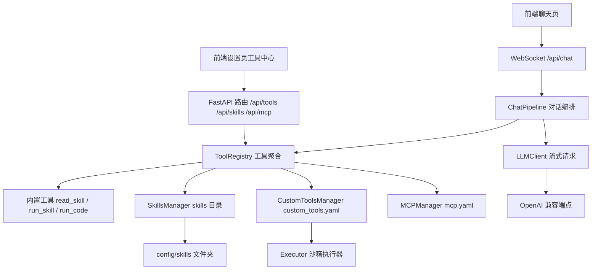
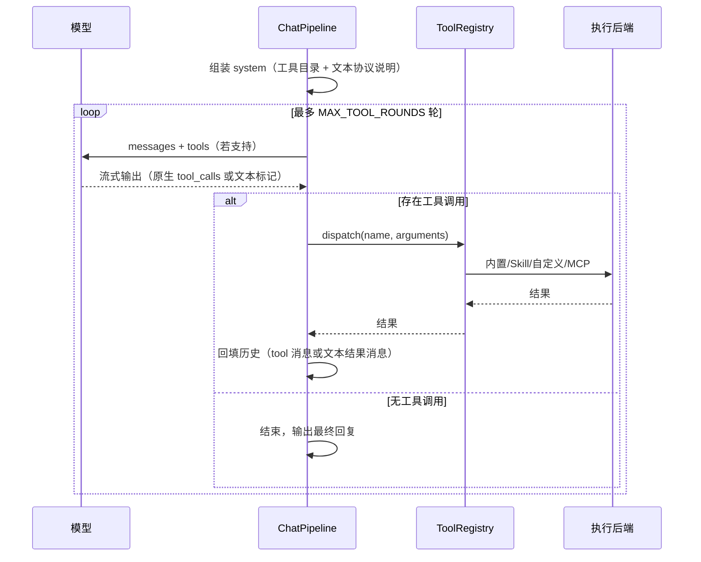

# AI 工具系统重设计 — 技术设计

Feature Name: ai-tool-system
Updated: 2026-08-28

## Description

将工具体系从「skills+MCP 全量注入 tools 参数」重构为「统一工具注册 + system prompt 工具目录 + 双模式调用协议 + 设置页工具中心」。AI 每轮对话都明确知道自身工具清单，按需读取 Skill 详情后自行调用；用户可在设置页管理自定义工具（HTTP/Python）、上传 Skill 文件夹、增删改 MCP 服务器。

已确认决策：

1. 双模式调用协议：支持 function calling 的模型走原生 tools 协议；R1 等不支持的模型自动回退文本协议（ReAct 标记）。
2. 自定义工具同时支持 HTTP 模板型与 Python 代码型。
3. Skill 支持 zip 整包上传（manifest 校验）+ 文件在线编辑。

## Architecture



### 核心机制：工具目录 + 双模式协议

- ChatPipeline 在每轮推理前组装 system 消息：工具目录（分组清单）+ 文本协议格式说明。
- 同时：端点支持 function calling 时照常传 `tools` 参数；不支持时（LLMClient 已缓存的降级状态）省略 `tools` 参数。
- 解析顺序：原生 `tool_calls` 优先；无原生调用时解析文本 `<tool_call>{...}</tool_call>` 标记兜底。两种来源统一进入执行循环。



## Components and Interfaces

### 1. ToolRegistry（新，`backend/app/services/tool_registry.py`）

统一聚合四类工具来源。

```python
class ToolRegistry:
    def __init__(self, skills, mcp, custom, executor): ...
    def collect_tools(self) -> list[dict]          # 全部可用工具的 function definitions
    def build_directory(self) -> str               # system prompt 用的分组目录文本
    async def dispatch(self, name, arguments) -> dict   # 统一分发：内置→skill→custom→mcp
    def snapshot(self) -> list[dict]               # 前端工具中心数据（含来源、启停）
```

内置工具：

| 工具 | 参数 | 行为 |
|------|------|------|
| `read_skill` | `name: string` | 返回 Skill 完整说明：manifest 描述、参数说明、SKILL.md 全文（如有） |
| `run_skill` | `name`, `arguments` | 执行 Skill 入口脚本（沿用现 subprocess 逻辑） |
| `run_code` | `code: string` | 走 Executor 沙箱执行 Python 代码 |

内置工具可通过 `config/tools.yaml` 的 `builtin.enabled` 整体启停（默认全开）。

### 2. CustomToolsManager（新，`backend/app/services/custom_tools.py`）

- 存储：`config/custom_tools.yaml`，结构见 Data Models。
- 名称约束：`^[a-zA-Z][a-zA-Z0-9_]{0,63}$`，与内置工具、Skill、MCP 工具名冲突时拒绝保存。
- HTTP 型执行：httpx；URL 中 `{param}` 占位由同名参数替换（URL-encode），其余参数按 `body_mode`（json/form/none）构造请求体；headers 模板支持 `{param}` 替换。
- Python 型执行：用户代码约定定义 `def run(args) -> dict`；网关拼接固定 runner（校验 run 存在、结果 JSON 可序列化、截断超长输出），写入临时文件走现有 `Executor.execute(code, script=True)`，受沙箱内存/CPU/超时限制。

### 3. SkillsManager 增强（`backend/app/services/skills.py`）

- `read_skill(name) -> dict`：manifest 元数据 + SKILL.md 内容（约定文件名 `SKILL.md`，manifest 可用 `doc` 字段覆盖）。
- `import_zip(data: bytes) -> dict`：zipfile 校验与解压。安全约束：仅接受 `.zip`；解压前逐条目校验目标路径位于目标目录内（防 zip slip）；条目数与解压后总大小设上限（默认 500 文件 / 20MB）；必须含 `manifest.yaml` 或 `manifest.yml` 且 `name` 字段与 zip 顶层目录名（或用户指定名）一致；同名 Skill 覆盖前先备份为 `<name>.bak-<ts>`。
- `list_files(name) -> tree`、`read_file(name, rel_path)`、`write_file(name, rel_path, content)`：路径规范化后强制限制在 Skill 目录内；`write_file` 仅接受 UTF-8 文本且单文件 ≤ 256KB。
- `delete(name)`：整目录删除（前端二次确认）。
- `function_definitions()` 改为**不再**输出 Skill 全量定义（Skill 通过目录 + read_skill + run_skill 消费）；保留 `directory_entries()` 输出 name/description 清单。

### 4. MCPManager 增强（`backend/app/services/mcp_client.py`）

- `connect_one(name)` / `disconnect_one(name)` / `upsert(cfg)` / `remove(name)`：单服务器热重连与移除，配置变更时仅重建对应 handle。
- 保留 `function_definitions()`（MCP 工具仍走原生注入：MCP 工具数量可能多且为标准 function schema，适合原生协议）。

### 5. ChatPipeline 重构（`backend/app/services/chat.py`）

- `collect_tools()` 委托 ToolRegistry。
- `run_full` 开头组装 system 消息：`build_directory()` 产出目录 + 固定的文本协议说明段；若 messages 已含 system（压缩回注场景）则合并到现有 system 头部。
- 文本协议格式（注入 system 的说明）：

```
当你需要使用工具时，只输出以下标记（可带前后思考文字）：
<tool_call>{"name": "工具名", "arguments": {"参数": "值"}}</tool_call>
每次只调用一个工具。系统会执行工具并以 <tool_result> 标记返回结果，收到结果后继续。
```

- 工具结果回填：
  - 原生协议：沿用 `role: tool` + `tool_call_id`。
  - 文本协议：assistant 消息原样入库，结果以 user 消息回填：`<tool_result name="...">{json}</tool_result>\n请根据工具结果继续。`
- 解析：一轮流式输出完成后，若存在原生 `completed_calls` 则跳过文本解析；否则正则 `<tool_call>\s*(\{.*?\})\s*</tool_call>`（DOTALL，取全部匹配，逐个执行）。标记外的正文若存在则先作为 delta 推送过（流式已推送），仅当「输出只含调用标记、无实质正文」时避免重复推送。
- `MAX_TOOL_ROUNDS` 沿用（5）。

### 6. API 端点（`backend/app/routers/api.py`）

| 方法 | 路径 | 说明 |
|------|------|------|
| GET | `/api/tools` | 工具中心快照（分组：builtin/skills/mcp/custom，含启停与描述） |
| GET/POST | `/api/tools/custom` | 自定义工具列表 / 创建 |
| GET/PUT/DELETE | `/api/tools/custom/{name}` | 详情 / 更新 / 删除 |
| PUT | `/api/tools/custom/{name}/enabled` | 启停 |
| POST | `/api/tools/custom/{name}/test` | 测试运行（body 传参数） |
| POST | `/api/skills/upload` | zip 上传导入（multipart） |
| GET | `/api/skills/{name}/files` | 文件树 |
| GET/PUT | `/api/skills/{name}/files/{path}` | 读 / 保存文本文件 |
| DELETE | `/api/skills/{name}` | 删除 Skill |
| GET/POST | `/api/mcp/servers` | 列表 / 新增 |
| PUT/DELETE | `/api/mcp/servers/{name}` | 更新（含重连）/ 删除 |
| POST | `/api/mcp/servers/{name}/reconnect` | 手动重连 |

所有新端点挂 `Depends(require_auth)`。

### 7. 前端（`frontend/src/views/SettingsView.vue` + `src/api/`）

- 设置页新增「工具中心」标签页，四个子区：
  - 工具总览：按来源分组的表格（名称/描述/来源/启停开关）。
  - Skills：列表 + zip 上传（input file + 进度提示）+ 文件浏览器（树/编辑器 textarea 保存）+ 删除 + 启停。
  - MCP：服务器卡片（状态点、工具数）+ 新增/编辑表单（transport 切换 stdio/http 字段组）+ 删除 + 重连。
  - 自定义工具：列表 + 新增/编辑表单（type 切换 http/python 字段组，python 用 textarea，JSON Schema 参数编辑器用 JSON textarea + 校验）+ 测试运行（参数 JSON 输入 → 显示结果）。
- `src/api/` 新增 `tools.js`（自定义工具）、扩展 skills/mcp 接口封装。

## Data Models

### custom_tools.yaml

```yaml
tools:
  - name: query_stock
    description: 查询股票行情
    enabled: true
    type: http
    parameters:
      type: object
      properties:
        symbol: {type: string, description: 股票代码}
      required: [symbol]
    http:
      method: GET
      url: "https://api.example.com/stock/{symbol}"
      headers:
        Authorization: "Bearer xxx"
      body_mode: json        # none | json | form
  - name: calc_hash
    description: 计算文本哈希
    enabled: true
    type: python
    parameters:
      type: object
      properties:
        text: {type: string}
    code: |
      def run(args):
          import hashlib
          return {"md5": hashlib.md5(args["text"].encode()).hexdigest()}
```

### Skill 目录约定

```
config/skills/<name>/
├── manifest.yaml     # 必须：name/description/entry/timeout/parameters/enabled
├── SKILL.md          # 可选：AI 按需读取的使用文档
└── run.py            # 入口脚本
```

### 文本协议消息形态（会话记录）

```json
{"role": "assistant", "content": "...<tool_call>{...}</tool_call>..."}
{"role": "user", "content": "<tool_result name=\"x\">{...}</tool_result>\n请根据工具结果继续。"}
```

## Correctness Properties

1. 工具目录完整性：`GET /api/tools` 的工具集合与 `collect_tools()` 返回的定义集合一一对应（除禁用项）。
2. 协议幂等：同一轮输出中原生调用与文本标记互斥处理，同一工具结果恰好回填一次。
3. 名称唯一性：工具名全局唯一（内置 < Skill < custom < mcp_ 前缀空间互不冲突），冲突时保存被拒绝且报错明确。
4. 路径安全：所有 Skill 文件读写与 zip 解压的目标路径规范化后必须位于对应 Skill 目录内。
5. 沙箱不变量：Python 型自定义工具与 run_code 一律经过 Executor，受 sandbox.yaml 限流约束。
6. 历史可回放：文本协议的历史消息经 `_normalize_messages` 后仍为合法 OpenAI 消息（user/assistant role）。

## Error Handling

| 场景 | 处理 |
|------|------|
| zip 无 manifest / name 不一致 / 超限 | 400，明确中文错误，不写任何文件 |
| zip slip / 非法路径 | 400，拒绝该条目并中止导入 |
| 自定义工具名冲突 / 非法名 | 400 |
| 自定义 HTTP 工具执行失败 | 结果含 `error` 字段回填模型，前端卡片标记失败 |
| Python 工具 run 未定义 / 结果不可序列化 | runner 捕获，返回结构化错误 |
| MCP 单服务器连接失败 | 状态标记 unavailable，其余 server 与内置工具继续可用 |
| 文本协议标记残缺（截断/JSON 非法） | 该轮视为普通回复结束，不执行；连续两轮无法解析时在目录说明中附加「请严格按格式输出」提醒（可选实现，不计入验收） |
| read_skill 名称不存在 | 返回可用 Skill 列表的错误结果（作为工具结果，非 HTTP 错误） |

## Test Strategy

后端单测（unittest，沿用现有 `tests/` 风格）：

- `test_tool_registry.py`：目录文本生成、四来源聚合、dispatch 路由、名称冲突检测。
- `test_custom_tools.py`：http 参数替换（URL/headers/body）、python runner 成功/失败/超时、CRUD 校验。
- `test_skills_io.py`：zip 导入成功/缺 manifest/slip 攻击样本/超限、文件树与读写路径逃逸拦截、read_skill 返回。
- `test_react_protocol.py`：文本标记解析（单调用/多调用/无标记/残缺标记）、结果回填消息形态、与原生 tool_calls 互斥。
- `test_chat_pipeline.py` 扩展：ReAct 模式端到端（fake client 输出标记 → fake 工具 → 二轮文本回复）。

前端：`npm run build` 通过；工具中心四子视图手动验证 CRUD 与上传。

## References

[^1]: backend/app/services/chat.py — 现有工具循环与消息归一化
[^2]: backend/app/services/skills.py — 现 Skill 加载/执行/启停
[^3]: backend/app/services/mcp_client.py — 现 MCP 连接与分发
[^4]: backend/app/services/sandbox.py — Executor 沙箱执行入口
[^5]: backend/app/core/config.py — Settings 热刷新机制
