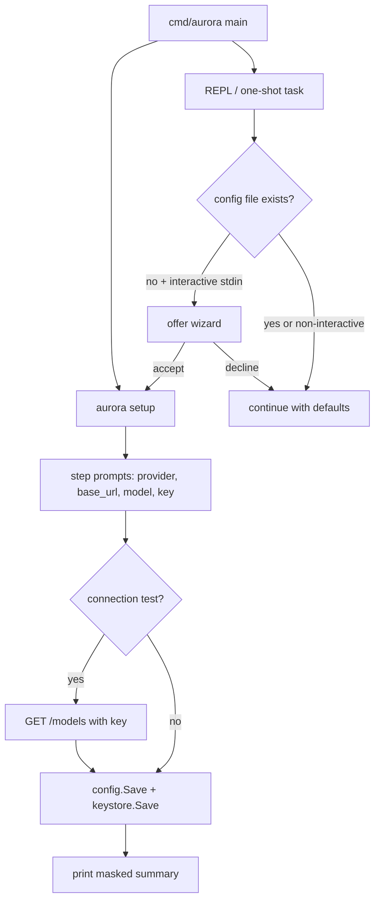

# First-Run Setup Wizard

Feature Name: first-run-setup-wizard
Updated: 2026-11-08

## Description

An interactive step-by-step configuration wizard (`aurora setup`) plus automatic first-run detection, modeled on Hermes Agent's `hermes setup`. A new user picks a provider preset, endpoint, model, and API key; the wizard saves config atomically, stores the key in a dedicated dotenv file, and offers a cheap connection test. On first launch without a config file, Aurora offers to run the wizard before starting the REPL or a task.

## Architecture



The wizard lives in a new `internal/setup` package with no dependency on `internal/tui` or `internal/agent`; it takes an `io.Reader`/`io.Writer` pair so tests can script it. Provider presets and the key store extend `internal/config`. The connection probe reuses the same base URL and key the `internal/llm` client would use.

## Components and Interfaces

### `internal/config/providers.go` (new)

```go
type Provider struct {
    ID           string // "openai", "deepseek", "zhipu", "moonshot", "minimax", "ollama", "custom"
    Name         string // display name
    BaseURL      string // default base URL, empty for custom
    DefaultModel string // suggested model, empty for custom
}

func Providers() []Provider
```

Built-in presets (fixed order):

| ID | Base URL | Default model |
|----|----------|---------------|
| openai | `https://api.openai.com/v1` | `gpt-4o-mini` |
| deepseek | `https://api.deepseek.com/v1` | `deepseek-chat` |
| zhipu | `https://open.bigmodel.cn/api/paas/v4` | `glm-4-flash` |
| moonshot | `https://api.moonshot.cn/v1` | `moonshot-v1-8k` |
| minimax | `https://api.minimaxi.com/v1` | `MiniMax-M2` |
| ollama | `http://localhost:11434/v1` | `qwen3:4b` |
| custom | (prompted) | (prompted) |

### `internal/config/keystore.go` (new)

```go
func KeyStorePath() (string, error)                                    // <config dir>/.env
func LoadKeyStore() (map[string]string, error)                         // parse KEY=VALUE lines, ignore comments
func SaveKeyStore(name, value string) error                            // upsert, preserve other entries, 0600 on unix
```

`config.APIKey(cfg)` precedence changes to: key store value for `cfg.LLM.APIKeyEnv` → `os.Getenv(cfg.LLM.APIKeyEnv)` → `os.Getenv("OPENAI_API_KEY")`.

### `internal/config` additions

```go
func Exists() (bool, error)  // os.Stat(Path()) == nil
```

Wizard runs at most once per process; `Exists()` is checked before `Ensure()` writes defaults.

### `internal/setup/wizard.go` (new)

```go
type Options struct {
    In  *bufio.Reader
    Out io.Writer
    Cfg config.Config // prefill values from existing config
}

func Run(o Options) (config.Config, error) // returns the config to save; never saves itself
```

Steps (numbered selection, Enter accepts default):

1. Provider: list presets with default model hints; `1..7`.
2. Base URL: prefill preset URL; for custom, must be non-empty and trimmed of trailing `/`.
3. Model: prefill preset default; free text.
4. API key: free text; empty keeps no stored key. Summary masks all but first 4 chars.
5. Connection test `[Y/n]` (default yes): `GET {base_url}/models` with `Authorization: Bearer <key>`, 10s timeout. 2xx = pass; 401/403 = report invalid key; other = "reachable, verification inconclusive", treated as pass. Failure prints retry hint and proceeds to save (test is optional).
6. Confirm: show summary, `[Y/n]` save. EOF or declined at any step returns an error and saves nothing.

First-run offer in `cmd/aurora/main.go` `cmdREPL`: when `config.Exists()` is false and stdin is a TTY (`tui.IsInteractiveTTY()`, new: `os.Stdin` ModeCharDevice check), print a short offer and run the wizard on accept. `aurora run <task>` follows the same offer path. `loadCfg` switches from `Ensure()` to `Load()` for the detection path; `Ensure()` is still used by `init` and other commands to write the file.

`aurora setup` prefills from `config.Load()` (not `Ensure`, to avoid materializing defaults before the user confirms) and always shows all steps including the existing key's var name.

## Data Models

- `config.Config.LLM.APIKeyEnv` stays the env var name (default `AURORA_API_KEY`); the value lives in `<config dir>/.env` as `AURORA_API_KEY=sk-...`.
- Key store file format: `KEY=VALUE`, one per line, `#` comments ignored, no quoting needed, values used verbatim after `=`.
- Wizard state is plain `config.Config`; no new persisted types.

## Correctness Properties

- Wizard saves config and key store atomically: `config.Save` already writes tmp + rename; `SaveKeyStore` writes tmp + rename with 0600.
- Upsert: saving a key preserves unrelated keys already in the store.
- Abort safety: EOF/Ctrl+C at any step returns an error before any file write; existing config unchanged.
- Offer appears at most once per process and only when the config file is absent and stdin is a TTY.
- `APIKey` precedence: key store first, then env, then `OPENAI_API_KEY` last.

## Error Handling

- Save failure: print error, exit non-zero; tmp files left behind by rename failure are harmless.
- Probe network failure: print error + retry hint, continue to save (optional step).
- Probe 401/403: print "key rejected by endpoint", continue to save.
- Empty base URL for custom preset: re-prompt.
- Non-TTY stdin: skip offer entirely, no hang.

## Test Strategy

Go stdlib `testing`, scripted `bufio.Reader` input for the wizard:

- `providers_test.go`: unique IDs, non-empty base URL and default model for all presets except custom.
- `keystore_test.go`: round-trip; upsert preserves other entries; `APIKey` precedence store > env > OPENAI_API_KEY; 0600 perms on unix.
- `wizard_test.go`: full happy path with scripted input asserts saved fields; abort on EOF leaves config untouched; confirm-decline saves nothing; masked key in summary output.
- `exists_test.go`: `Exists()` false in temp config dir, true after Save.
- Connection probe: httptest server returning 200/401; both paths covered.

## References

[^1]: (Website) - Hermes Agent setup wizard flow, `hermes setup` provider/API key/model walkthrough: https://blog.gitcode.com/981761a489438e320cc1dc71b5d9df0f.html
[^2]: (File) - Current config load/save and env-var key resolution: `/workspace/internal/config/config.go`
[^3]: (File) - CLI subcommand routing and REPL entry: `/workspace/cmd/aurora/main.go`
[^4]: (File) - Existing prompt pattern (`Confirm`, `IsTTY`): `/workspace/internal/tui/repl.go`
[^5]: (File) - Requirements this design addresses: `/workspace/.monkeycode/specs/first-run-setup-wizard/requirements.md`
